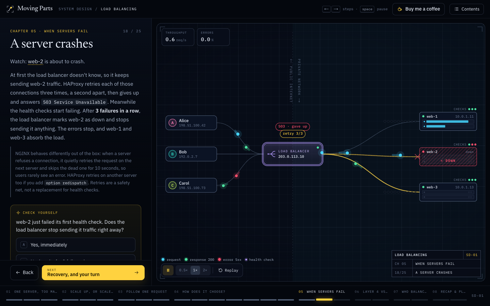

# Moving Parts

**Systems, animated.** Step-by-step animated lessons on system design, networking and computer science. Watch requests move, predict what happens next, and break things on purpose.

**Live: [learn-engineering.xyz](https://learn-engineering.xyz)**



Each lesson is a live simulation, not a slideshow. Things queue, fail and recover because the simulation says so. The lesson pauses to ask what happens next, hands you the controls to break it, and shows the real config (nginx, HAProxy, Redis, PostgreSQL…) behind each idea.

## The 25 lessons

| System design | Networking | Computer science |
| --- | --- | --- |
| [Load Balancing](https://learn-engineering.xyz/learn/load-balancing) | [What happens when you hit Enter](https://learn-engineering.xyz/learn/life-of-a-request) | [Processes vs Threads](https://learn-engineering.xyz/learn/processes-threads) |
| [Caching](https://learn-engineering.xyz/learn/caching) | [The OSI Model](https://learn-engineering.xyz/learn/osi-model) | [The Event Loop](https://learn-engineering.xyz/learn/event-loop) |
| [CDNs](https://learn-engineering.xyz/learn/cdn) | [TCP Handshakes & Reliability](https://learn-engineering.xyz/learn/tcp) | [Hash Tables](https://learn-engineering.xyz/learn/hash-tables) |
| [Consistent Hashing](https://learn-engineering.xyz/learn/consistent-hashing) | [DNS Resolution](https://learn-engineering.xyz/learn/dns) | [Stack vs Heap](https://learn-engineering.xyz/learn/stack-heap) |
| [Database Replication](https://learn-engineering.xyz/learn/replication) | [TLS & HTTPS](https://learn-engineering.xyz/learn/tls) | [Garbage Collection](https://learn-engineering.xyz/learn/garbage-collection) |
| [Sharding](https://learn-engineering.xyz/learn/sharding) | [HTTP/1.1 vs 2 vs 3](https://learn-engineering.xyz/learn/http-versions) | [CPU Caches](https://learn-engineering.xyz/learn/cpu-caches) |
| [Rate Limiting](https://learn-engineering.xyz/learn/rate-limiting) | [IP, Subnets & NAT](https://learn-engineering.xyz/learn/nat) | [Race Conditions & Locks](https://learn-engineering.xyz/learn/race-conditions) |
| [Message Queues](https://learn-engineering.xyz/learn/message-queues) | [WebSockets](https://learn-engineering.xyz/learn/websockets) | [Big-O, Visually](https://learn-engineering.xyz/learn/big-o) |
| [CAP & Consistency](https://learn-engineering.xyz/learn/cap) | | |

## Tested against the real thing

An animation can be internally consistent and still teach the wrong behavior. So the lessons' scenarios also run against the real software, configured with the exact snippet the lesson shows, and a test fails when the animation and the real program disagree.

That suite (`npm run verify`, in [`verify/`](verify/)) runs 175 tests and 323 comparisons across 19 lessons, against nginx, HAProxy, Redis, PostgreSQL, MySQL, Node.js and Chrome. It has caught 26 mistakes so far, such as HAProxy answering 503 rather than 502 for a crashed server. Snippets that pass carry a "tested on …" badge in the lesson; the full results are at [learn-engineering.xyz/tested](https://learn-engineering.xyz/tested).

## Run it locally

Needs Node.js 20.9 or newer.

```bash
git clone https://github.com/tawhidkuet04/learn_engineering.git
cd learn_engineering
npm install
npm run dev          # http://localhost:3000
```

| Command | What it does |
| --- | --- |
| `npm run dev` | Dev server with hot reload |
| `npm run build` | Production build: a static site in `out/` |
| `npm run lint` | ESLint |
| `npx vitest run verify/<lesson>.test.ts` | Check one lesson against the real software (see below) |
| `npm run verify` | Check every lesson (about 7 minutes) |

## How it's built

Next.js 16 (App Router, static export), React 19 and TypeScript. No UI or animation libraries: every stage is SVG drawn from a small simulation kit.

```
src/
  app/                  routes: home, /learn/[slug], /tested, share images
  components/lesson/    the lesson player: shell, timeline, code blocks, quizzes, cards
  components/stage/     SVG building blocks and overlays for the stages
  lib/sim/              the simulation base class, geometry, prediction game
  lessons/<slug>/       one folder per lesson: script (chapters.tsx), simulation, stage, panel
  content/              site name, topic catalog, test results for the badges and /tested
verify/                 the real-software checks
docs/AUTHORING.md       how to write a lesson, and the quality bar
```

A lesson is a list of chapters and steps. Each step sets up the simulation, adds narration, callouts, an interaction (predict, slider, toggle, click the stage) and a real-world snippet. [Load Balancing](src/lessons/load-balancing/) is the reference implementation, and [docs/AUTHORING.md](docs/AUTHORING.md) explains the kit.

## Checking lessons against real software

Each test file needs a few programs installed:

| Test file | Needs |
| --- | --- |
| `load-balancing` | nginx, HAProxy, openssl |
| `rate-limiting` | nginx, Redis |
| `caching` | Redis |
| `nginx-lessons` | nginx, openssl, curl |
| `postgres-lessons` | PostgreSQL, MySQL server |
| `js-runtime` | Google Chrome (or set `CHROME_PATH`), a JDK for one check |

On macOS: `brew install nginx haproxy redis postgresql@14 mysql openjdk`. Everything runs on 127.0.0.1 with random ports and temp directories.

Results depend on versions, and the badges say which versions were used. When you change a lesson, run only that lesson's file; its results replace only its own entries in `verify/results/` and `src/content/`. See [verify/README.md](verify/README.md) for how to write a check.

## Contributing

Found something wrong in a lesson? That's the most useful thing you can report: [open an issue](https://github.com/tawhidkuet04/learn_engineering/issues/new/choose), ideally with how the real software behaves. Pull requests are welcome; see [CONTRIBUTING.md](CONTRIBUTING.md).

## License

Code and lessons: [MIT](LICENSE). The fonts in `src/og/fonts` are under the [SIL Open Font License](src/og/fonts/OFL.txt).

If the lessons helped you, you can [buy me a coffee](https://buymeacoffee.com/tawhidj).
